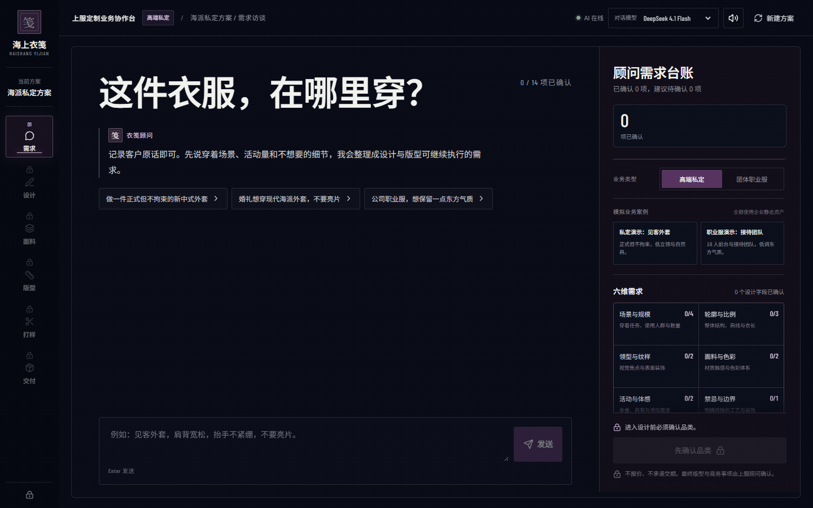

# 海上衣笺

面向上海服装集团定制业务专员、职业服方案设计师与高级定制企划人员的 AI 业务协作台。

项目参加 **DOAI FDE-03「海派定制服饰 AI 需求解构与可视化 Agent」**，目标是把客户口语访谈转成可确认、可匹配、可交接的结构化定制方案。



## 产品定位

这不是消费者换装工具，也不是自动报价系统。产品服务于高端私定与团体职业服两类业务，帮助业务人员在访谈现场完成需求确认、企业资源匹配、方案草稿、视觉提示词和台账交接。

完整流程包括：

1. 多轮需求访谈
2. 设计方向与款式图
3. 版型、面料、工艺与历史案例检索
4. 面料选择
5. 版型参数与风险提示
6. 打样检查
7. 成衣方案、视觉提示词与业务台账交接

最终版型、价格、交期和生产决策仍由业务人员确认。

## 核心能力

| 能力 | 当前实现 |
| --- | --- |
| 六维需求报告 | 将访谈整理为 14 个字段，按场景与规模、轮廓与比例、领型与纹样、面料与色彩、活动与体感、禁忌与边界分组，并区分已确认与待确认 |
| 审美标签报告 | 用带标签的结构化报告展示风格、情绪和设计取向，避免只给一段不可追溯的总结 |
| 品类安全门槛 | 必须确认品类和至少 3 个设计相关字段才能进入设计；品类是资源匹配硬约束，没有同品类资产时明确停止，不跨品类兜底 |
| 企业资产匹配 | 检索版型、面料、工艺与案例，展示匹配分、匹配理由、差距项和风险提示 |
| 方案初稿 | 汇总风格、轮廓、面料方向、领型衣长、工艺组合、适用场景与设计亮点 |
| 三套视觉提示词 | 分别生成成衣效果、工艺细节和上身穿搭提示词；只使用确认字段，支持单套复制、全部复制和导出 |
| 可追溯台账 | 合并需求、方案、提示词、资源快照、打样状态、可编辑业务备注和操作留痕，支持 Markdown 与 JSON 输出 |
| 异常降级 | 对话模型异常时回退到本地规则归纳；图像服务不可用时使用企业静态设计资产 |

## 本地运行

环境要求：Node.js 20+、pnpm 11+。

Windows 下可直接双击项目根目录的 `start.bat`。脚本会检查环境、安装缺少的依赖，并在服务就绪后打开浏览器。

也可以手动启动：

```powershell
pnpm install
pnpm dev
```

访问 `http://localhost:3000`。

## 环境变量

复制示例文件后填写服务端密钥：

```powershell
Copy-Item .env.example .env.local
```

密钥只放在 `.env.local`，由服务端 Route Handler 读取，不会进入浏览器。

DeepSeek：

```dotenv
DEEPSEEK_API_KEY=
DEEPSEEK_BASE_URL=https://api.deepseek.com
DEEPSEEK_DEFAULT_MODEL=deepseek-flash
```

当前账户可使用 `deepseek-flash` 和 `deepseek-v4-pro`。页面默认使用性价比更高的 `deepseek-flash`。

图像服务采用 OpenAI-compatible `/images/generations` 请求：

```dotenv
IMAGE_API_KEY=
IMAGE_API_BASE_URL=https://provider.example.com/v1
IMAGE_MODEL_FAST=flux-schnell
IMAGE_MODEL_BALANCED=seedream-4
IMAGE_MODEL_QUALITY=gpt-image-1
```

`IMAGE_API_BASE_URL` 为空或请求失败时，设计图会自动回退到企业静态设计资产。模型 ID 需要与最终采用的服务商一致。

## 验收结果

2026-11-25 本地验收结果：

| 检查项 | 结果 |
| --- | --- |
| TypeScript 类型检查 | `pnpm exec tsc --noEmit` 通过 |
| ESLint | `pnpm lint` 通过 |
| 生产构建 | `pnpm build` 通过 |
| P1 专项验收 | 27 / 27 项断言通过 |
| 两条完整业务案例 | 32 / 32 项断言通过 |
| 响应式布局 | 320-1440px 无横向溢出 |
| 网络降级 | 3 / 3 项断言通过 |
| 浏览器控制台 | 无错误 |

运行完整验收：

```powershell
node scripts/qa-layout.mjs
node scripts/qa-screenshots.mjs
node scripts/qa-resilience.mjs
node scripts/qa-p1.mjs
```

截图、报告和运行中间产物写入 `qa/`。该目录只用于本地验收，不提交到 Git。

## 项目结构

```text
src/app/             页面、全局样式与 Route Handlers
src/components/      工作台交互与业务阶段组件
src/lib/             六维需求、资源匹配、类型与业务规则
public/assets/       模拟企业版型、面料、工艺与案例资产
docs/                比赛说明、架构、Demo 脚本与验收方案
scripts/             响应式、端到端、P1 与降级验收脚本
data/handoffs/       本地生成的完整台账 JSON
```

## 数据与边界

- 版型、面料、工艺、案例、款式图、版型图和打样图来自静态模拟企业档案。
- 已确认需求、AI 提示词、资源快照、版型参数、打样记录和操作留痕会合并为同一份台账。
- 用户提交的台账以完整 JSON 形式写入 `data/handoffs/`，前端可导出 Markdown。
- 页面只收集完成定制承接所需的信息。
- 不自动报价，不承诺交期，不执行生产下单。
- 不连接真实 CRM、生产系统或客户业务 API。
- `.env.local` 和 `data/handoffs/*.json` 均被 `.gitignore` 排除，避免提交密钥或运行数据。

## 比赛文档

- [命题逐条对应](docs/competition-requirements.md)
- [架构、数据来源与业务闭环](docs/architecture.md)
- [Agent 能力边界清单](docs/agent-boundary.md)
- [3 分钟 Demo 与 8 分钟路演脚本](docs/demo-script.md)
- [验收与用户验证方案](docs/validation.md)

## 提交前事项

本仓库提供的是可本地运行、可自动化验收的参赛原型。公网 Demo 地址、Demo 视频和生产级服务端存储属于提交阶段事项，不在当前仓库内提供。当前本地台账未做生产级权限、加密、留存期限和审计接入，不能直接用于真实客户数据。

## 技术栈

- Next.js 16
- React 19
- TypeScript
- Motion
- Lucide Icons
- DeepSeek Chat Completions
- OpenAI-compatible image generation adapter
